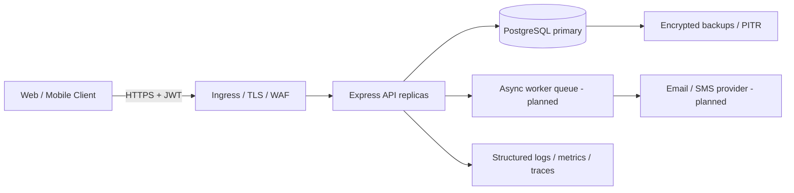
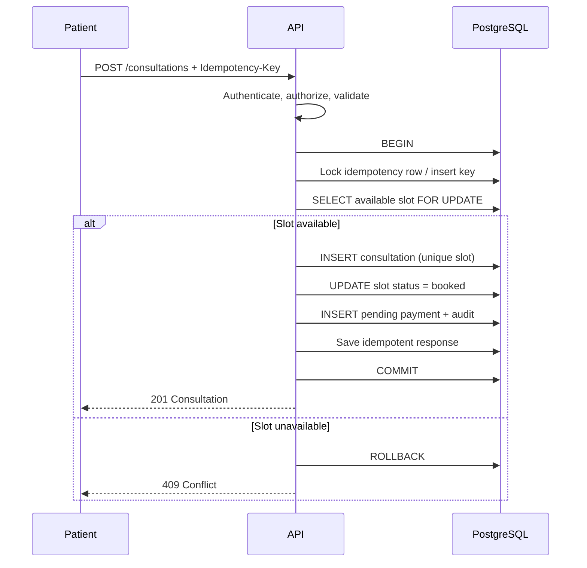
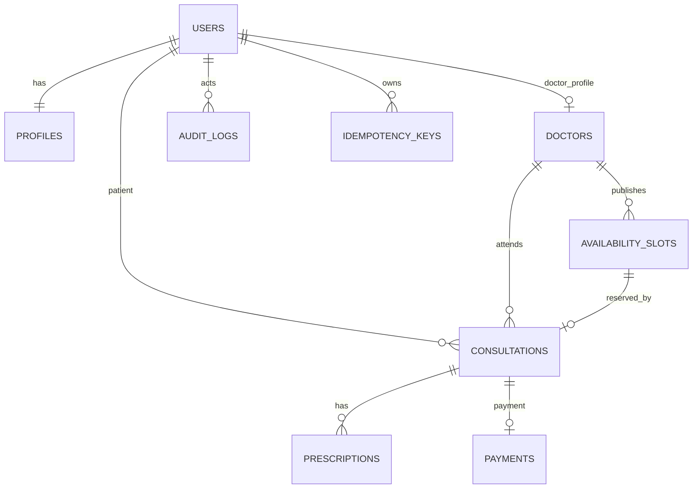

# Architecture and Design

## 1. Overview
The submission is a modular-monolith reference implementation: a Node.js 20 / Express REST API, PostgreSQL as the system of record, and Docker Compose for a reproducible local environment. Modules are separated into routes, middleware, database access, and audit services. This is intentionally simpler to operate than microservices for an assignment, while keeping boundaries that can later be extracted.

### High-level architecture

### Request flow
1. Client sends JSON over HTTPS with a short-lived Bearer token where required.
2. Request ID middleware attaches or generates a correlation ID.
3. Helmet, CORS policy, JSON body limit and rate limiter apply.
4. Zod validates body fields; role middleware checks access.
5. Parameterized SQL is executed through a bounded connection pool.
6. Sensitive mutations run in database transactions and create audit records.
7. A consistent JSON response includes a request ID for troubleshooting.

## 2. Booking flow sequence

## 3. Data model / ER diagram

## 4. Transaction management and idempotency
Booking is an ACID transaction. `SELECT ... FOR UPDATE` serializes attempts to reserve the same slot, `availability_slots.status` records the reservation, and unique constraints on `consultations.slot_id`, `(patient_id,idempotency_key)`, and `idempotency_keys(user_id,key)` add database-level protection. A repeated key returns the stored response when available. Clients must use a unique key per logical booking. For a distributed deployment, persist a request fingerprint and reject same-key/different-payload requests; this reference implementation does not yet fingerprint payloads.

## 5. Retries, timeouts and backoff
- Retry only transient failures (`40001`, `40P01`, selected `5xx`) with bounded exponential backoff and jitter.
- Do not blindly retry writes unless the same idempotency key is reused.
- Set DB connection and statement timeouts at deployment; use request deadlines and cancellation in a hardened deployment.
- External payment/notification calls should use an outbox + worker, provider idempotency keys, bounded retries and a dead-letter queue. No real payment provider or notification worker is included here.
- Avoid retrying validation, authorization, and other 4xx failures.

## 6. Caching and concurrency
- PostgreSQL is authoritative for bookings. Do not rely on cache to reserve slots.
- Doctor search can use short-lived Redis caching once invalidation rules are defined. Redis is optional and not included in the starter.
- Invalidation should happen on doctor profile/verification/availability changes.
- Row locks and unique constraints prevent concurrent double-booking. At high throughput, measure lock contention and consider partitioning by time range.
- Use keyset pagination rather than large offsets for high-volume tables.

## 7. Data partitioning and scale
100,000 consultations/day averages about 1.16 consultations/second; peak traffic may be many times higher. Use realistic load tests to determine sizing. First scale horizontally with stateless API replicas, connection pooling (e.g. PgBouncer), indexes, query plans, read replicas for analytics, and async jobs for noncritical tasks. Consider monthly range partitioning of consultations and audit logs once table size and retention policy justify it. Partitioning and replicas are design recommendations, not configured in this repo.

## 8. Reliability, backup and disaster recovery
Target availability in the assignment is 99.95% (about 21.6 minutes monthly downtime). This repository does not establish that SLA. A production plan would require multi-AZ PostgreSQL, automated encrypted backups, point-in-time recovery, tested restore drills, defined RPO/RTO, regional recovery procedures, and monitored failover. Suggested starting objective: RPO <= 5 minutes and RTO <= 60 minutes, to be validated with the business. Store backups in a separate account/project with restricted access and retention lock where available.

## 9. Observability
- Structured JSON logs include request IDs; do not log passwords, tokens, prescription content, or health details.
- `/health/live` checks process liveness; `/health/ready` checks PostgreSQL.
- Production: export RED metrics (request rate, errors, duration) and DB pool/connection/lock metrics to Prometheus; use OpenTelemetry for distributed traces and an OTLP collector.
- Alert on elevated 5xx, p95 latency, DB saturation, queue age, failed backups, and availability budget burn. Exporters and tracing SDK are deployment follow-ups, not wired in this starter.

## 10. API boundaries
REST endpoints are versioned under `/api/v1`. See `../openapi.yaml`. All SQL uses parameter binding. The API does not include a real telehealth video integration, payment gateway, email/SMS, or a production MFA enrollment/verification flow.
